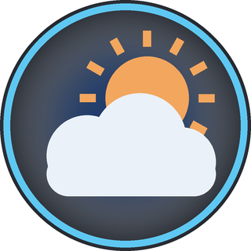

<p align="center"></p>

<h1 align="center">AURA</h1>
<h3 align="center">Atmospheric Utility & Reporting Automaton</h3>
<p align="center"><i>The DREAM Robotics weather station</i></p>

<div align="center">

[](https://x.com/NorowaretaGemu) [](https://opensource.org/licenses/MIT)

</div>

<div align="center">
  <a href="https://ko-fi.com/cursedentertainment">
    
  </a>
</div>

<div align="center">
  
  
  
  
  
</div>

---

- Robot Type: Weather station (a PC program with her own Arduino sensor)

<div align="center">
  
  <p><i>AURA</i></p>
</div>

**Site:** [cursedprograms.github.io/AURA](https://cursedprograms.github.io/AURA/)

The fleet's weather station. AURA knows what it's like outside, what it's like in every room a robot is in, and plots one against the other.

---

## What she does

- **Outside:** the current weather where you are, from [Open-Meteo](https://open-meteo.com/) (open source, free, no API key): temperature, feels-like, humidity, wind, today's high and low, and the chance of rain. It's refreshed every 10 minutes.
- **Her own sensor:** an AHT10 temperature and humidity sensor on an Arduino over USB (`scripts/aura_sensor`), the same sensor and code as MILA's.
- **The fleet:** every robot that already reports temperature and humidity: MILA (`/status`), NORA (`/sensors`), and anything else with `temp` / `hum` in its status. She finds them in RIFT's fleet list and asks them every minute, over WiFi, or over Bluetooth for a robot you list in `Bluetooth`. A robot can also push its reading: `POST /report`.
- **The graph:** inside against outside (outside dashed), temperature or humidity, over 6 hours, 24 hours or 7 days. One reading a minute per source is kept for 7 days in `data/history.csv`.
- **The sky:** sunrise, sunset and the UV index (Open-Meteo), and the moon's phase, worked out on the PC (no internet needed): how lit it is and the days to the next full moon.
- **Obsessed with the weather:** she has NINA's storyteller (Karpathy's 15M TinyStories model, NumPy only, no GPU) and every story is about the weather: she opens it with the real sky ("Today there was light rain and it was cold...") and the little model tells the rest. **Tell me a weather story** on her page, or `GET /story`. Ask her anything and she brings it back to the weather.
- **Ask her:** `GET /ask?q=...`: the weather, a robot's readings ("how warm is it at MILA?"), the moon, sunrise and sunset, or a story. DREAM asks her this way.
- **Brainfuck, like the fleet:** she registers `talk:5017`, so RIFT's conversations include her (`/chirp?u=`, beeped on the PC speaker in her light voice). When DREAM asks for the weather, DREAM beeps "wx?" (utterance 17) first and AURA beeps the sky back in one word: sun, cloud, rain, fog, snow, storm, hot or cold (18-25, RIFT's `Fleet/talk_bf.json`). Then DREAM says AURA's answer in words.
- **In her own words:** "It's 27° and mostly clear outside, a 69% chance of rain today, so take an umbrella, 22° in here, MILA has the warmest spot at 25°."

The internet she uses comes through the fleet: everything on the "RIFT" WiFi shares the hub PC's connection (RIFT's README, "The fleet network").

## Quick start

1. Flash `scripts/aura_sensor/aura_sensor.ino` to an Arduino UNO or Nano, wired to an AHT10: VIN to 5V (or 3.3V), GND to GND, SDA to A4, SCL to A5. Plug it into the PC.
2. Run `run.bat`. The first time, it sets up `venv` and installs `requirements.txt`. Her page is at **http://127.0.0.1:5017/**.
3. Or open **`builds/aura.exe`**: her page in a window. It starts `run.bat` if she isn't running.

She finds her Arduino by herself: the port that answers `WHO` with `I am AURA`.

## Apps

- **Windows:** [`builds/aura.exe`](builds/aura.exe). Keep it in `builds/`. Source: `scripts/web_controller` (`build.bat`, Visual Studio 2022).
- **Android:** `Android App/` (package `com.synthwomb.aura`), her page full screen. FIND gets her address from RIFT's fleet list, or type it in. Install: [`AURA-debug-2026-11-05.apk`](Android%20App/apk/AURA-debug-2026-11-05.apk). Build it with `gradlew assembleDebug` (JDK 17).

## Settings (`config.json`, `Config.AURA`)

| Setting | Default | What it does |
|---|---|---|
| `Port` | `5017` | Her page and API |
| `RiftHost`, `RiftPort` | `127.0.0.1`, `5000` | Where RIFT's fleet list is: she registers there and reads the robots from it |
| `Location` | empty | `Latitude` + `Longitude` (and a `Name`), or a `City` that Open-Meteo looks up. Empty: a guess from your network's public address |
| `Units` | `C` | `C` or `F` |
| `WeatherMinutes` | `10` | How often she asks Open-Meteo |
| `FleetSeconds` | `60` | How often she asks the robots |
| `BoardPort`, `BoardBaud` | `auto`, `9600` | Her Arduino: found by itself, or a port like `COM5` |
| `HistoryDays`, `SampleSeconds` | `7`, `60` | How long readings are kept, and one per how many seconds per source |
| `Bluetooth` | `{}` | Robots to read over Bluetooth instead of WiFi: `{"NORA": "COM7"}` (the port the paired robot got, or its address) |
| `BluetoothServer` | `true` | Her own API over Bluetooth serial too (`fleet_bt.py`, RFCOMM channel 1), for controllers without WiFi |
| `FleetLadder` | `false` | The fleet's WiFi ladder: her rung is after TINA (RIFT > DREAM > NINA > TINA > AURA > the controllers...). Off, like NINA's and DREAM's, she just registers with RIFT |

## API

| Request | Answer |
|---|---|
| `GET /api/now` | Outside, every room's latest reading, where she is, what she says, and any problems |
| `GET /api/history?hours=24` | Every source's readings: `[time, temp, hum]` |
| `GET /ask?q=...` | Her answer in words, and her Brainfuck word for the sky (`chirp=1`: she beeps it too) |
| `GET /story` | A weather story (about 10 s) |
| `GET /chirp?u=n` | Beeps utterance n of RIFT's phrasebook, in her voice (RIFT's conversations) |
| `GET /status` | Like any robot's: `temp`, `hum` (hers), `outside_temp`, `outside_hum`, `weather`, `says` |
| `POST /report` | `{"name": "KIDA01", "temp": 23.1, "hum": 45}` from a robot that would rather push |
| `GET /ping` | `AURA alive` |

She registers with RIFT as `weather` with `weather,climate,web:5017,talk:5017,ask:5017`. RIFT's **Ask & tell** shows her temperature and humidity and, from Open-Meteo, outside.

Her Arduino, at 9600 baud: `TEMP:21.4` and `HUM:48.2` every 5 s, `AHT_ERROR` when the sensor doesn't answer. `WHO` answers `I am AURA`, `READ` measures now.

## Tests

```
venv\Scripts\python.exe -m pytest tests
```

Readings in every robot's format, the history file, her sentences, the location and weather (no network), the moon, her Brainfuck word for the sky, her answers, and the API.

## Files

```
aura.py                     her server: weather, Arduino, fleet, history, page, API
config.json                 her settings
fleet_bt.py, fleet_ladder.py  the fleet's Bluetooth link and WiFi ladder (master copies: RIFT/Fleet)
story.py                    the storyteller (NINA's, with weather openings); its model goes in models/
templates/, static/         her page (HTML, CSS, JS: the graph is a plain canvas)
scripts/aura_sensor/        the Arduino sketch (AHT10)
scripts/web_controller/     builds/aura.exe
Android App/                the Android app
tests/                      pytest
index.html, site/           the GitHub Pages site
```

Her colours: the night sky (`#070B14`), her sky blue (`#5EC8F2`) and the sun's amber (`#F2A65E`).

---

<!-- DREAM-ECOSYSTEM:START -->

---

<div align="center">&copy; Cursed Entertainment 2026</div>

<div align="center">
  <a href="https://cursed-entertainment.itch.io/">
    
  </a>
</div>

---

## The DREAM Robotics ecosystem

**Minds** — [DREAM](https://github.com/CursedPrograms/DREAM) companion · [TINA](https://github.com/CursedPrograms/TINA) engineer · [NINA](https://github.com/CursedPrograms/NINA) caretaker · [RIFT](https://github.com/CursedPrograms/RIFT) fleet hub · [LYCEA](https://github.com/CursedPrograms/LYCEA) training school  
**Robots** — [NORA](https://github.com/CursedPrograms/NORA-Robot-v00) · [MILA](https://github.com/CursedPrograms/MILA-Robot-v00) · [WHIP](https://github.com/CursedPrograms/WHIP-Robot-v00) · [KIDA-00](https://github.com/CursedPrograms/KIDA-Robot-v00) · [KIDA-01](https://github.com/CursedPrograms/KIDA-Robot-v01) · [IDA](https://github.com/CursedPrograms/IDA-Robot-v00) · [ARM](https://github.com/CursedPrograms/ARM-Robot-v01) · [NIKA](https://github.com/CursedPrograms/NIKA-Robot-v00) · [ARIA](https://github.com/CursedPrograms/ARIA-Robot-v00) · [AURA](https://github.com/CursedPrograms/AURA) weather  
**Remotes** — [RITA](https://github.com/CursedPrograms/RITA) handheld remote  
<!-- DREAM-ECOSYSTEM:END -->
